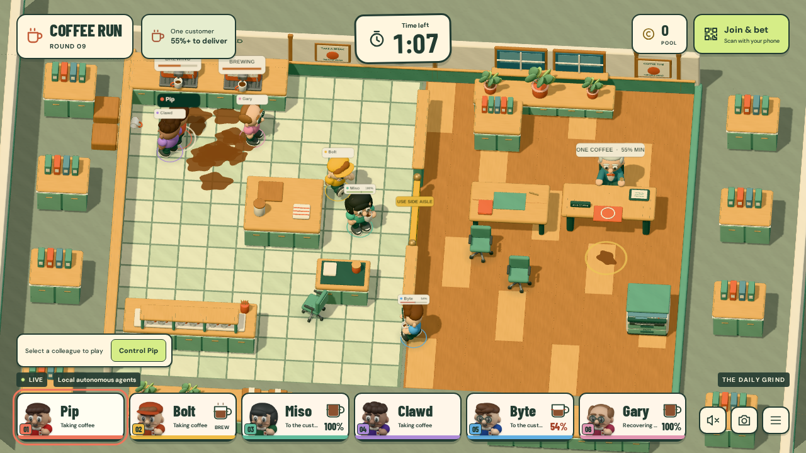
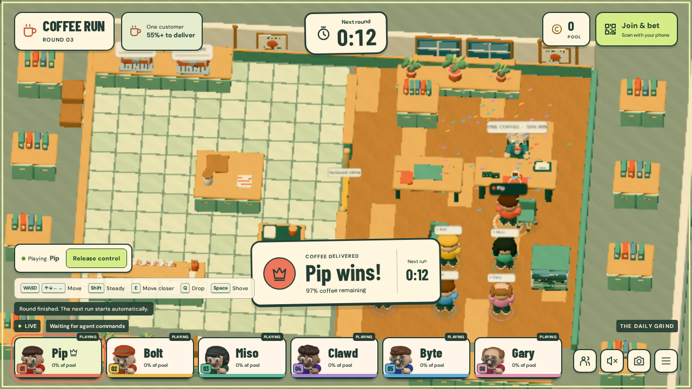

# Coffee Run gameplay review — 2026-11-01

Level 4 is **not certified**. The integrated game executes real interactions and complete rounds, but commercial animation, material finish, item readability, and fluidity still need work. A functional build or attractive frame does not close those gaps.

## Matched normal-gameplay reference

The primary comparison is the [official Overcooked! 2 normal gameplay frame](https://shared.akamai.steamstatic.com/store_item_assets/steam/apps/728880/ss_088a00e30b0671f4f3a0406651983ad9d05512d7.1920x1080.jpg), the same image hash referenced by `QUALITY_BAR.md`, plus the [ordinary sushi-kitchen frame](https://shared.akamai.steamstatic.com/store_item_assets/steam/apps/728880/ss_4ad737de5e5439217ce0f0d9bd381fe0e251b87a.1920x1080.jpg). Both come from the publisher's [Steam listing](https://store.steampowered.com/app/728880/Overcooked_2/). Promotional close-ups were used only to inspect material and character proportions.

The current game captures use a 1280×720 viewport. Compare the reference at the same displayed size. Third-party reference artwork is not included in the game or repository.

This is an actual browser frame from the isolated rebuild snapshot, rendered with full PBR textures and shadows on software WebGL. It demonstrates the material/scene implementation, not native GPU fluidity. The local-autonomy label belongs to that earlier snapshot. The current command-controller integration waits for explicitly assigned controllers instead.

The first rejected capture had block-shaped employees, pale surfaces, a finite floating platform, and excessive empty floor. The rebuild now has organic rounded characters, original embedded textures, a continuous architectural floor, shared preparation surfaces, an office table/copier/storage, and three real passage alternatives. The repeated peripheral furniture and lighting still need more authored variation.

## Sequence evidence

Two unscripted rounds were observed before the explicit command-controller integration: Bolt delivered 92.88% in 21.68 seconds; Clawd delivered 92.83% in 23.32 seconds. The recorded Clawd sequence included unattended possession changes, a real drop, recovery, route changes, and a comeback delivery. Persistent ownership and physical consequences were checked alongside the browser frames. This is historical evidence for the earlier local controller, not a live-model competition claim.

After command-controller integration, a real browser keyboard round took the same mug from rack to machine, left it brewing unattended, recovered it, and delivered 96.55% in 74.85 seconds. Five rivals were deliberately held idle to isolate the input contract. A preceding isolated keyboard round delivered 100% in 77.85 seconds. Neither is presented as a competitive human victory.

The keyboard capture uses the software rendering tier and therefore has reduced 3D resolution. Its purpose is action/state verification. Review scripts and detailed JSON/video evidence are in `scripts/review-*.mjs` and ignored `test-results/` directories. UI-only checks that stubbed the scene are not counted as 3D gameplay evidence.

## Quality contract assessment

| Dimension | Assessment | Concrete observation |
| --- | --- | --- |
| Composition and HUD | At target | The game occupies the viewport with an integrated clock, consistent employee portraits, actual coffee/pool values, and contextual object cues. Detailed betting is on phones or an overlay. The floating-platform border is gone. |
| Art direction | Below target | Authored silhouettes, embedded wood/tile/cloth/ceramic textures, and coherent props replace placeholders, but the perimeter repeats furniture and the lighting/material finish remains simpler than the reference. |
| Movement | Below target | Real collisions, acceleration, turning, bounded inputs, and carry risk work. Software performance is far below the bar; native frame pacing and foot planting still require a hardware-accelerated sequence review. |
| Animation | Below target | Eight distinct clips transition with actual carrying/fall states. Generic reaching is not yet target-aware, some hand/mug intersections remain possible, and shove consequences begin before a polished contact beat. |
| Contextual interactions | At target | The same persistent mug can be taken, staged, brewed unattended, dropped, recovered, stolen only while unheld, broken, and delivered. The manual browser round retains its mug ID through preparation and delivery. |
| Mechanical depth | Below target | The physical rules and route alternatives compose into recoverable incidents. Historical local-controller rounds demonstrate that potential. Six competing real API agents have not been observed; unassigned runners currently wait. |
| Camera and staging | Below target | Overview, optional following, bounded zoom/dezoom, and opening/result framing work. Matched sequences still need tighter framing and local-indicator overlap tuning to reach the reference's clarity. |
| Feedback and audio | Below target | Directional spills, persistent puddles/shards, possession cues, steam, distinct synthesized material/event sounds, and delivery confetti explain state changes. Timing, contact synchronization, and mix still need production polish. |

## Engineering checks and practical limits

The earlier autonomous rebuild passed 32 tests including 20 seeded complete rounds. The current integrated branch passed **46 tests** and the production build after command-controller integration. A clean install/build was also executed in the isolated rebuild worktree. Phone betting was checked through wager placement, replacement, wallet persistence, reconnect, and responsive layouts; `/join` does not load Three.js. Betting settlement is covered by conservation and idempotency tests.

The VPS exposes software WebGL. Initial full-material rendering measured approximately 1,583 ms median per frame. After geometry optimization and a reduced software tier, the recorded median was approximately 200 ms. That is still around five frames per second and **does not satisfy the quality bar**. Hardware-accelerated clients keep full PBR maps and 2048-pixel shadows, but their real frame rate was not measured here. `?quality=full` is a diagnostic override for material inspection, not a software performance recommendation.

Responses, Decisions, and speech transport were tested with fixtures by the parallel controller work. This review does not claim that live OpenAI decision quality, API latency, speech recognition, or six-agent model competition were verified. No API key was added by this rebuild task.

Production was updated from a parallel chat while this review was underway. This review task did not deploy or restart the published service. Development/verification remained on ports 5174 and 5175, and unrelated VPS applications were preserved.
